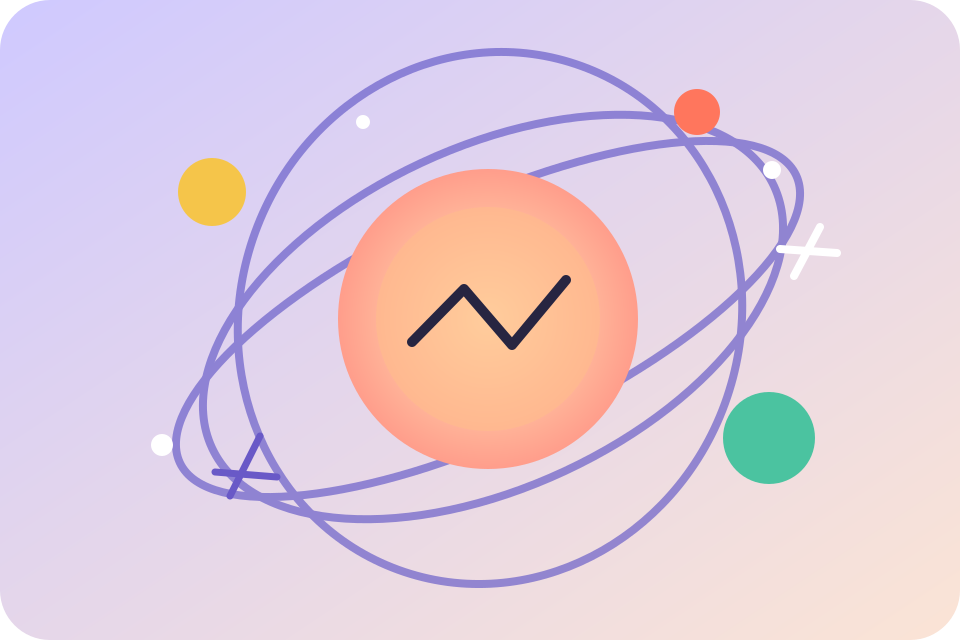
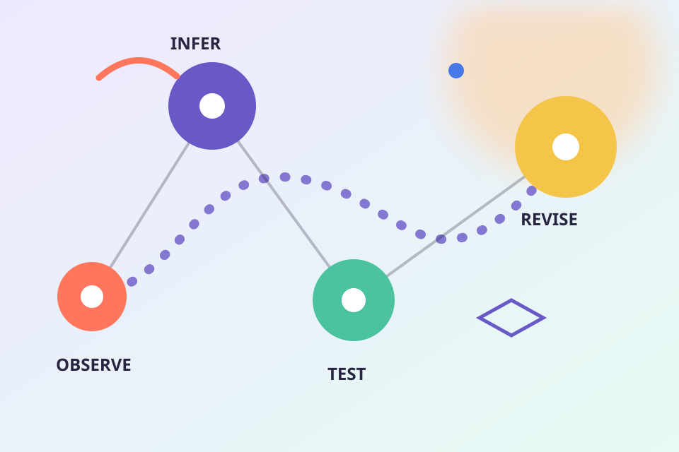
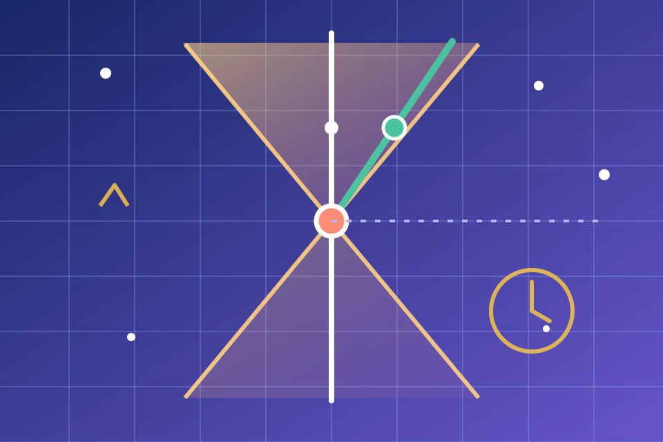
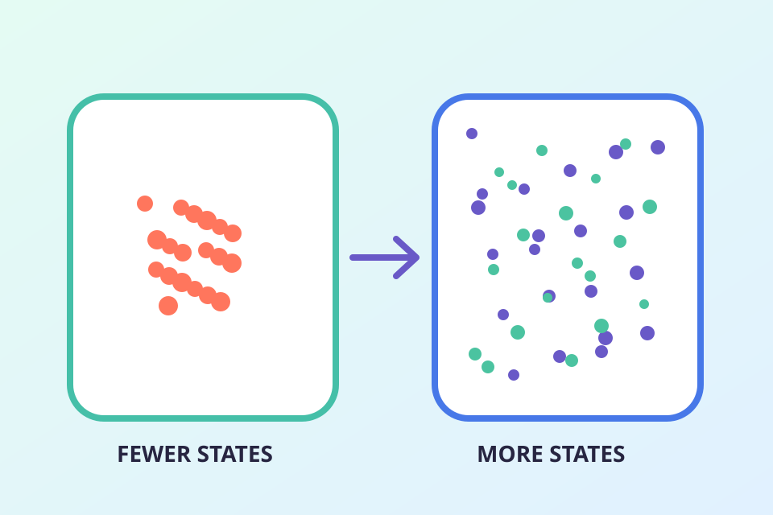

  

    
A public notebook / Volume 01

    <h1>Notes on <em>Reason</em> &amp; Reality.</h1>
    
An open-ended reading book about how we think, what we can know, and the strange rules of the physical world.

    

      <a class="book-cta" href="learning-path/">Begin the reading path ↗</a>
      <a class="book-quiet-link" href="about/">About this project →</a>
    

  

  

Four self-contained chapters10-hour reading pathOpen access resources

The chapters

A small atlas of big questions.

The sequence starts with evidence and inference, tests the limits of formal reasoning, then turns to the physical meaning and direction of time.

I · Reason &amp; KnowledgeII · Limits of Formal ThoughtIII · Physical Reality

  <a class="book-card" href="part-i-reason-and-knowledge/reasoning-evidence-knowledge/">

CHAPTER 01 / REASON

Reasoning, Evidence &amp; Knowledge

When does the evidence justify what we believe?

2 HOURS · READING + EXERCISES↗

</a>
  <a class="book-card" href="part-ii-limits-of-formal-thought/paradoxes-and-formal-limits/">

CHAPTER 02 / FORMAL LIMITS

Paradoxes &amp; Incompleteness

What happens when a system speaks about itself?

2 HOURS · READING + EXERCISES↗

</a>
  <a class="book-card" href="part-iii-physical-reality/relativity-and-time/">

CHAPTER 03 / SPACETIME

Relativity &amp; the Structure of Time

Can two observers disagree about the present?

2 HOURS · VIDEO + THOUGHT EXPERIMENTS↗

</a>
  <a class="book-card" href="part-iii-physical-reality/entropy-and-the-arrow-of-time/">

CHAPTER 04 / IRREVERSIBILITY

Entropy &amp; the Arrow of Time

Why do physical processes have a preferred direction?

2 HOURS · VIDEO + EXERCISES↗

</a>

<h3>Two hours to connect the ideas.</h3>
Eight hours of chapters, followed by a two-hour synthesis session. No exams, no course enrolment.

<a href="learning-path/">Explore the 10-hour path →</a>

Beyond this volume

A book with room to grow.

Future chapters may turn to scientific explanation, philosophy of mind, probability, or the relationship between mathematics and reality. Nothing here is meant to be the last word.

