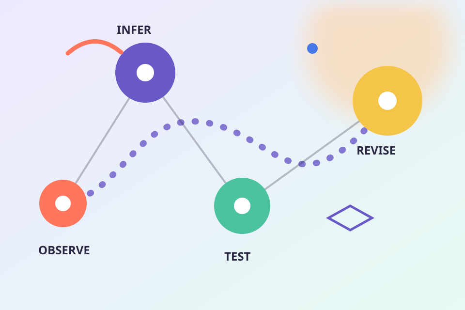

Part I / Reason & Knowledge · Chapter 01

# Reasoning, Evidence & Knowledge

A good explanation can be persuasive without being logically guaranteed. How should we decide what to believe when more than one account fits the facts?

2 hoursReading-ledOne argument map

## What to learn

- Distinguish **deduction**, **induction**, and **abduction** without treating them as interchangeable.
- Tell apart an argument's **validity**, the truth of its premises, and the strength of its evidential support.
- Compare explanations by identifying what each predicts and what additional evidence would help discriminate between them.
- Explain why revising a belief in light of new evidence need not mean the original belief was irrational.

## Questions to carry

1. Can a conclusion be reasonable without being certain?
2. When does an explanation account for the evidence rather than merely fit it?
3. How should new evidence change a judgement?
4. Does the best available explanation have to be the true one?

## The two-hour study plan

00–20

Before reading, write an example of an argument that is persuasive but not conclusive. Why is it persuasive?

20–55

Read OpenStax §5.4. Make a three-column comparison of deduction, induction, and abduction. Watch one short Wi-Phi explanation if useful.

55–95

Complete the <b>competing explanations</b> exercise below. List observable implications of each explanation.

95–120

Read the opening discussion in Stanford's <i>Abduction</i>. Write a six-sentence note on why explanatory virtues are not a deductive proof.

## Read & watch

Essential · Read<strong><a href="https://openstax.org/books/introduction-philosophy/pages/5-4-types-of-inferences">OpenStax — Types of Inferences</a></strong>
A clear first pass at deductive, inductive, and abductive inference. Focus on the definitions and worked examples.

Short video · Optional<strong><a href="https://www.wi-phi.com/videos/">Wireless Philosophy — Critical Thinking videos</a></strong>
Choose the short videos on inductive or abductive arguments. No need to watch an entire series.

Stretch · Read<strong><a href="https://plato.stanford.edu/entries/abduction/">Stanford Encyclopedia of Philosophy — Abduction</a></strong>
Begin with the introduction and the account of inference to the best explanation. The full entry is optional.

<h3>Exercise · The competing explanations test</h3>
A set of plants near a window grows faster than the plants at the back of the room.
<ol><li>Offer <b>three distinct explanations</b> for the difference.</li><li>What evidence is consistent with all three?</li><li>Design one simple observation or intervention that would help separate them.</li><li>State which inferences, if any, would be deductively valid.</li></ol>

## One-page notebook prompt

Write 150–200 words beginning with: **“An explanation is not the same as a proof because…”** Include one example and one possible counterexample to your own account.

## Before moving on

- [ ] I can classify an inference as deductive, inductive, or abductive.
- [ ] I can give an example of strong evidence that still leaves alternatives open.
- [ ] I can name a piece of evidence that would change my mind.
