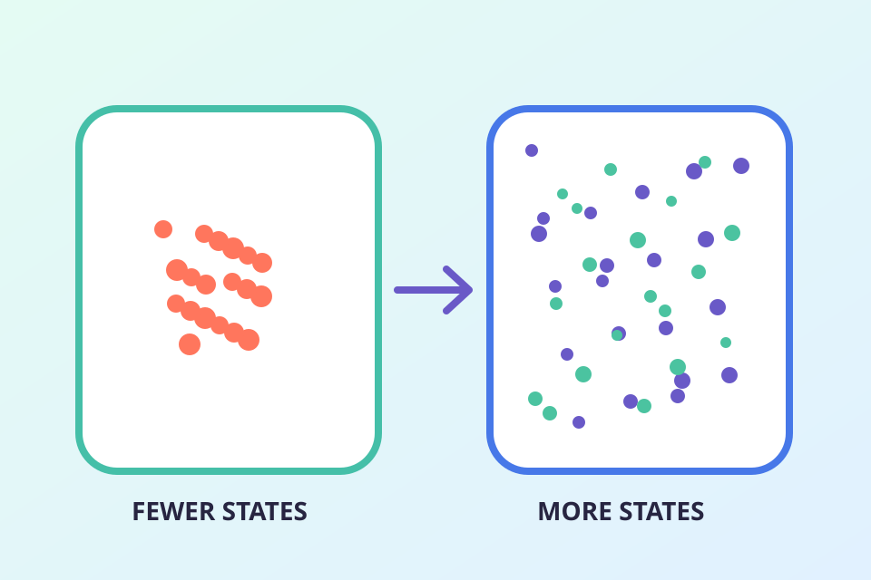

Part III / Physical Reality · Chapter 04

# Entropy & the Arrow of Time

Ice melts. Perfume spreads. Memories point towards yesterday, not tomorrow. What do these ordinary asymmetries have to do with the number of microscopic ways a system can be arranged?

2 hoursVideo + statistical intuitionOne counting exercise

## What to learn

- Distinguish a **microstate** from a **macrostate** and explain why many microstates can correspond to the same macroscopic description.
- Interpret the Boltzmann relation <strong>S = kB ln Ω</strong> for a specified macrostate with equally likely accessible microstates.
- State the second law in terms of entropy change for an **isolated system**, with statistical qualifications.
- Explain why the arrow of time is a further question beyond whether fundamental equations are approximately time-reversal invariant.

## Questions to carry

1. Why does an initially localised gas tend to spread through its container?
2. Is entropy simply a measure of “disorder”?
3. Why do time-reversible microscopic equations permit irreversible-looking macroscopic processes?
4. What role does the low-entropy past play in explaining the direction of time?

## The two-hour study plan

00–20

Before watching anything, describe why cream mixes into coffee but does not spontaneously unmix.

20–50

Watch Khan Academy's <i>Entropy intuition</i>. Note where the word “disorder” is helpful and where it misleads.

50–90

Read the short LibreTexts entropy account and work through the counting exercise.

90–120

Read or sample MIT's second-law lecture. Write a distinction between a statistical trend and a strict mechanical impossibility.

## Read & watch

Essential · Video<strong><a href="https://www.khanacademy.org/science/physics/thermodynamics/laws-of-thermodynamics/v/entropy-intuition">Khan Academy — Entropy Intuition</a></strong>
A short conceptual introduction. Treat “disorder” as an analogy, not a definition that always works.

Essential · Read<strong><a href="https://chem.libretexts.org/Bookshelves/Physical_and_Theoretical_Chemistry_Textbook_Maps/Chemical_Thermodynamics_%28Supplement_to_Shepherd_et_al.%29/06%3A_Fundamental_5_-_Entropy/6.01%3A_Entropy">Chemistry LibreTexts — Entropy</a></strong>
Focus on the microscopic/statistical account and the definition of entropy.

Stretch · Video<strong><a href="https://ocw.mit.edu/courses/3-020-thermodynamics-of-materials-spring-2021/resources/mit3_020s21_lecture_05_1080p_mp4/">MIT OCW — Second Law and Entropy Maximization</a></strong>
Selective viewing only; this lecture is more formal than the introductory video.

<h3>Exercise · Counting possible worlds</h3>
Imagine four distinguishable particles. Each can be in the left or right half of a box with equal probability.
<ol><li>How many microscopic left/right configurations are possible?</li><li>How many put all four particles on the left?</li><li>How many put two particles on each side?</li><li>Which macroscopic distribution is more probable, and why?</li><li>What does this tiny model explain—and what does it leave out?</li></ol>

## One-page notebook prompt

Complete the sentence: **“Entropy gives macroscopic time a direction because…”** Then write a second paragraph explaining why this alone does not settle every philosophical question about time or the universe's initial conditions.

## Before moving on

- [ ] I can count simple microstates for a defined macrostate.
- [ ] I can explain entropy without relying solely on the phrase “everything becomes more chaotic”.
- [ ] I can distinguish the arrow of time from the relativity of simultaneity.
