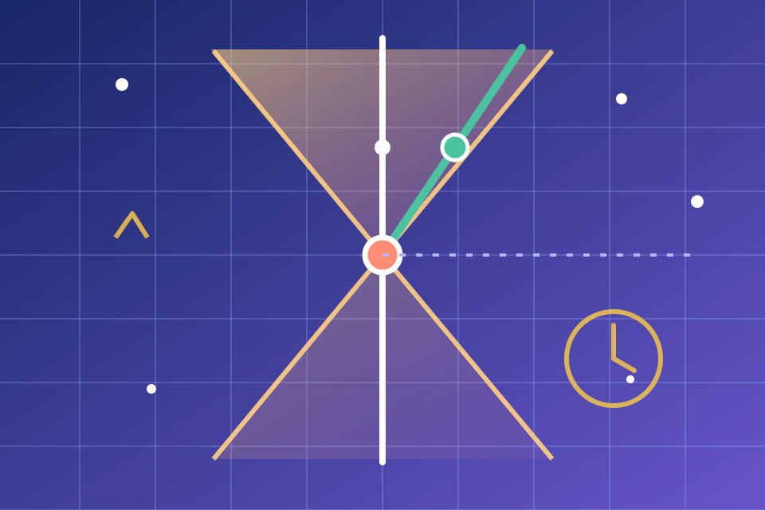

Part III / Physical Reality · Chapter 03

# Relativity & the Structure of Time

What counts as “at the same time”? Relativity begins with a surprising answer: it depends on how the observers move.

2 hoursLecture + diagramOne calculation

## What to learn

- State the two postulates of **special relativity** and distinguish it from general relativity.
- Explain why distant simultaneity is relative to inertial reference frames.
- Use the **light-clock thought experiment** to motivate time dilation.
- Interpret the Lorentz factor and explain that proper time is measured along a particular clock's worldline.

## Questions to carry

1. Can two observers both be right when they disagree about whether distant events were simultaneous?
2. Which quantities are frame-dependent, and which are invariant?
3. Why does the light clock depend on the invariant speed of light?
4. Does relative time mean that everything is subjective?

## The two-hour study plan

00–20

Sketch two trains moving past a platform. Can the observers agree on the order of distant events?

20–55

Watch MIT's lecture on time dilation, pausing at the light-clock construction.

55–95

Redraw the light clock and complete the numerical exercise. State what each time interval refers to.

95–120

Find the course's discussion of simultaneity. Write a short note on what remains physically invariant.

## Read & watch

Essential · Video<strong><a href="https://ocw.mit.edu/courses/8-20-introduction-to-special-relativity-january-iap-2021/resources/lecture-4/">MIT OCW 8.20 — Lecture 4.1: Time Dilation</a></strong>
Focus on the thought experiment, assumptions, and the meaning of the time intervals.

Reference · Course<strong><a href="https://ocw.mit.edu/courses/8-20-introduction-to-special-relativity-january-iap-2021/resources/lecture-videos/">MIT OCW — Introduction to Special Relativity</a></strong>
Browse the lecture index for spacetime and simultaneity. Watching the entire course is unnecessary.

<h3>Exercise · The moving clock</h3>
A spacecraft travels at <strong>0.8c</strong> relative to Earth. An onboard clock measures 30 minutes between two events that occur at the same location on the craft.
<ol><li>Calculate the Lorentz factor <code>γ = 1 / √(1 − v²/c²)</code>.</li><li>How much coordinate time elapses in the Earth frame between those events?</li><li>Which interval is the proper time, and why?</li><li>Explain why the result does <em>not</em> establish an absolute preferred frame.</li></ol>

## One-page notebook prompt

Explain relativity of simultaneity without saying that time is merely an illusion. Separate the operational question (how clocks are synchronised and compared) from the philosophical question (what a “present” might mean).

## Before moving on

- [ ] I can explain a light clock with a labelled sketch.
- [ ] I can calculate time dilation for a specified relative speed.
- [ ] I can distinguish frame-dependent measurements from invariants.
